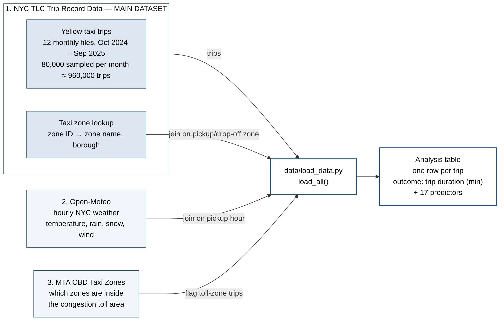

# Data

Everything our project uses comes from **three free, public sources**. None of it comes from Kaggle.
The main dataset is NYC taxi trips. The other two add weather and the congestion-toll zone to each trip.



## At a glance

| # | Dataset | Provider | What we use it for | Period | Size used |
|---|---|---|---|---|---|
| 1 | **TLC Trip Record Data: Yellow Taxi Trip Records** (main) | NYC Taxi & Limousine Commission | One row per taxi trip: the outcome (trip duration) and most predictors | Oct 2024 – Sep 2025 | 12 monthly files, 80,000 trips sampled per month ≈ **960,000 trips** |
| 1b | Taxi Zone Lookup (part of the TLC data) | NYC Taxi & Limousine Commission | Turns zone IDs into zone names and boroughs | – | 265 zones |
| 2 | **Historical Weather API** | Open-Meteo | Hourly temperature, rain, snow and wind, matched to each trip's pickup hour | Oct 2024 – Sep 2025 | ≈ 8,760 hourly rows |
| 3 | **MTA Central Business District Taxi Zones** | MTA, via data.ny.gov | Marks trips into the congestion pricing (toll) zone | Zones as of 2024 | One small table |

## 1. TLC Trip Record Data: Yellow Taxi Trip Records (main dataset)

- **What it is:** the official record of every yellow taxi trip in New York City, published monthly by the city.
- **Main page:** https://www.nyc.gov/site/tlc/about/tlc-trip-record-data.page
- **Column meanings (data dictionary):** https://www.nyc.gov/assets/tlc/downloads/pdf/data_dictionary_trip_records_yellow.pdf
- **File format:** Parquet, one file per month, read with `pd.read_parquet`.
  Example: `https://d37ci6vzurychx.cloudfront.net/trip-data/yellow_tripdata_2025-01.parquet`
- **Zone lookup:** https://d37ci6vzurychx.cloudfront.net/misc/taxi_zone_lookup.csv
- **Why these months:** they cover the 3 months before and 9 months after congestion pricing began on 5 January 2025.

**Columns we keep:**

| Column | Meaning |
|---|---|
| `tpep_pickup_datetime` | Pickup date and time |
| `tpep_dropoff_datetime` | Drop-off date and time (only used to calculate the outcome) |
| `passenger_count` | Number of passengers |
| `trip_distance` | Trip distance in miles |
| `RatecodeID` | Rate type (for example 2 = JFK airport flat rate) |
| `PULocationID` | Pickup taxi zone ID |
| `DOLocationID` | Drop-off taxi zone ID |

**Columns we leave out on purpose:** fare, tip, tolls, surcharges, fees and total amount. They are calculated from the trip itself, so using them would leak the answer.

## 2. Open-Meteo Historical Weather

- **What it is:** free historical weather data, no account or API key needed.
- **Page:** https://open-meteo.com/en/docs/historical-weather-api
- **Exact download we use (CSV):** hourly weather for New York City (40.7128, −74.0060), New York local time, Oct 2024 – Sep 2025:
  `https://archive-api.open-meteo.com/v1/archive?latitude=40.7128&longitude=-74.0060&start_date=2024-10-01&end_date=2025-09-30&hourly=temperature_2m,precipitation,snowfall,wind_speed_10m&timezone=America%2FNew_York&format=csv`
- **Columns after loading:** `time`, `temperature_c`, `precipitation_mm`, `snowfall_cm`, `wind_speed_kmh`
- **Licence:** CC BY 4.0. Credit Open-Meteo in the report.

## 3. MTA Central Business District Taxi Zones

- **What it is:** the list of taxi zones inside the congestion pricing zone (Manhattan's Central Business District).
- **Page:** https://catalog-beta.data.gov/dataset/mta-central-business-district-taxi-zones
- **CSV download:** https://data.ny.gov/api/views/yfdc-w5jh/rows.csv?accessType=DOWNLOAD
- **What we use:** only the zone ID column, to flag trips that start or end in the toll zone.

## Files in this folder

| File | What it is | Created by |
|---|---|---|
| `load_data.py` | The code everyone uses to load the data | Written by us |
| `data_sources.png` | The diagram above | Written by us |
| `trips_sample.csv.gz` | The ≈ 960,000 sampled trips (compressed CSV, opens with `pd.read_csv`) | `load_trips()`, first run |
| `taxi_zone_lookup.csv` | Zone ID → zone name and borough | `load_zones()`, first run |
| `weather_hourly_nyc.csv` | Hourly NYC weather | `load_weather()`, first run |
| `cbd_taxi_zones.csv` | Toll-zone taxi zones | `load_cbd_zone_ids()`, first run |

The trip sample is saved as a **compressed CSV** (`.csv.gz`) because a plain CSV of 960,000 rows would be over GitHub's 100 MB file limit. pandas reads it exactly like a normal CSV.

## How to use it (every time)

In any Colab notebook, run this first:

```python
!git clone https://github.com/<github-username>/<repo-name>.git
%cd <repo-name>

from data.load_data import load_all
data = load_all()

trips = data["trips"]                # one row per taxi trip
zones = data["zones"]                # zone ID -> zone name, borough
weather = data["weather"]            # hourly NYC weather
cbd_zone_ids = data["cbd_zone_ids"]  # set of toll-zone zone IDs
```

- **The first time** (done once, by one person): the trip download takes about 5–10 minutes. Afterwards, that person commits the new files in `data/` to GitHub.
- **After that:** everyone else loads the saved files from the repository in a few seconds, so the whole team works with exactly the same trips.
- Never change the sampling settings at the top of `load_data.py` (months, 80,000 per month, seed 42) without telling the team.

## How to cite the data in the report

1. NYC Taxi and Limousine Commission, "TLC Trip Record Data: Yellow Taxi Trip Records," Oct. 2024 – Sep. 2025. [Online]. Available: https://www.nyc.gov/site/tlc/about/tlc-trip-record-data.page
2. Open-Meteo, "Historical Weather API," CC BY 4.0. [Online]. Available: https://open-meteo.com/en/docs/historical-weather-api
3. Metropolitan Transportation Authority, "MTA Central Business District Taxi Zones," data.ny.gov, 2024. [Online]. Available: https://catalog-beta.data.gov/dataset/mta-central-business-district-taxi-zones
